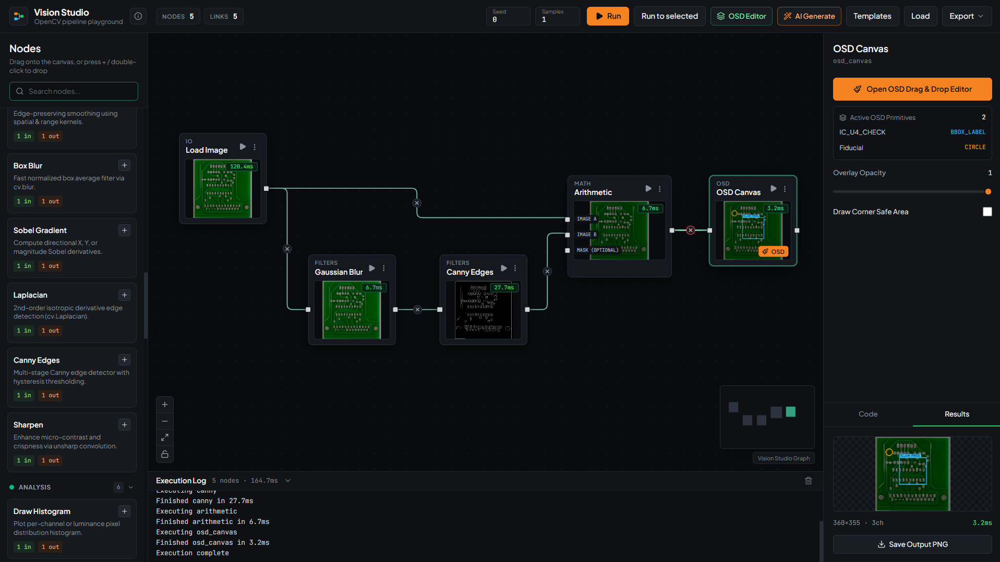
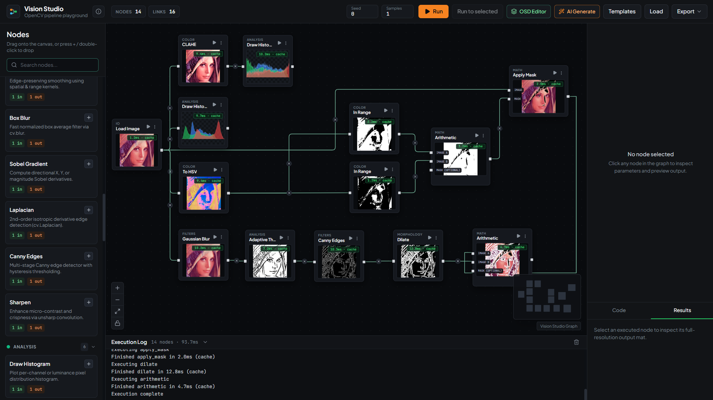
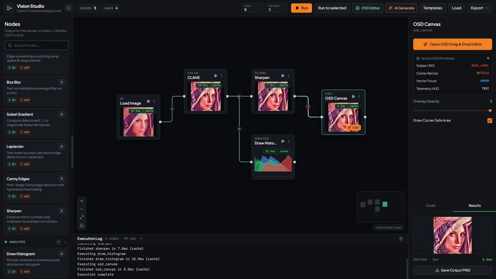
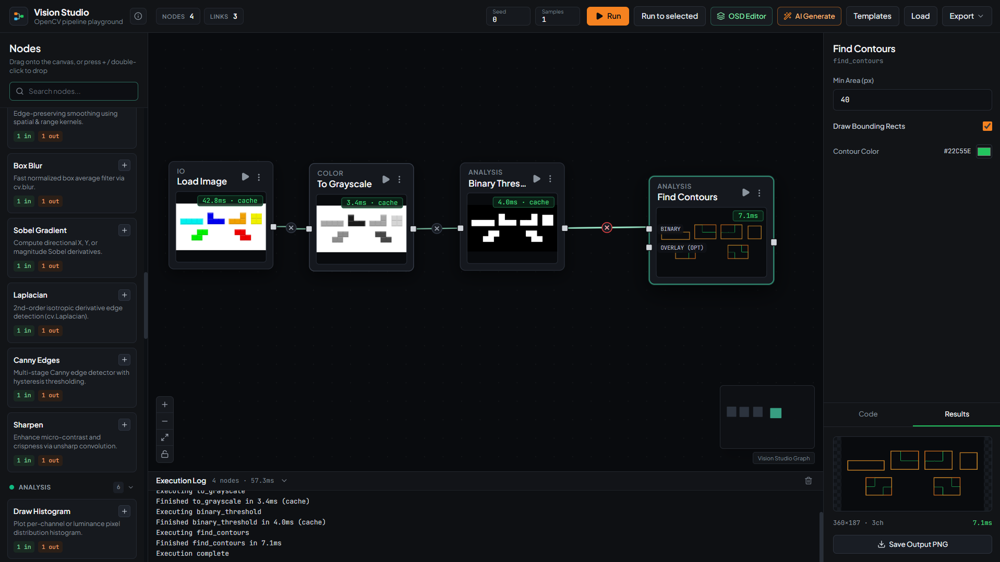
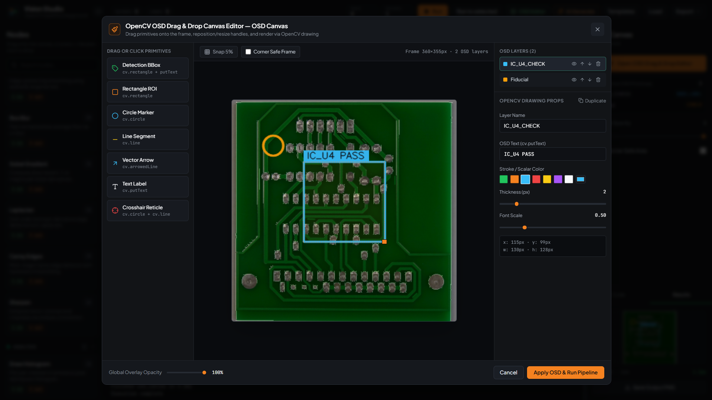
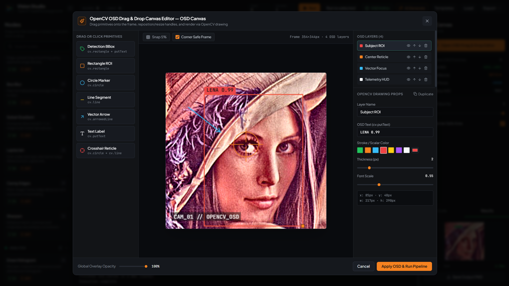
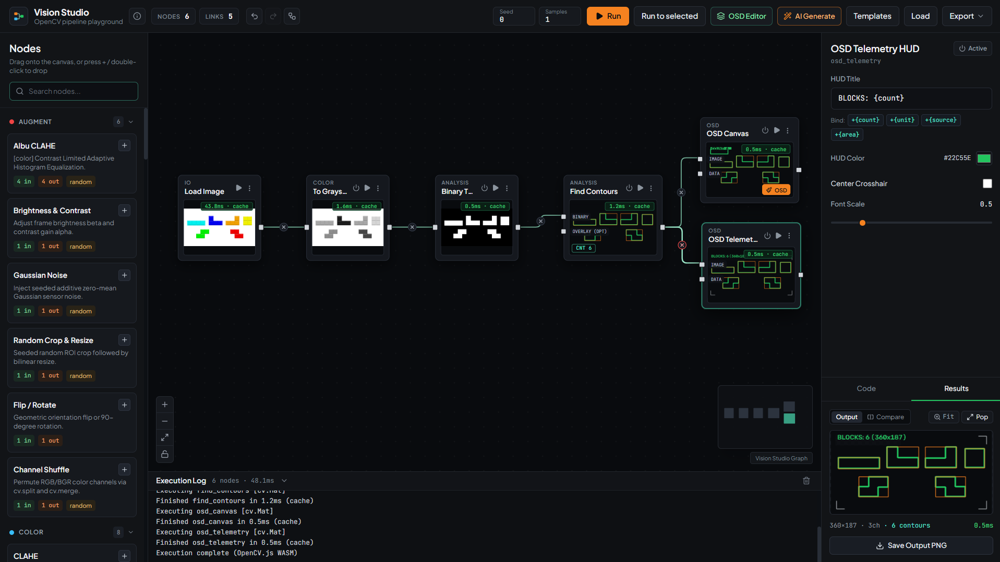
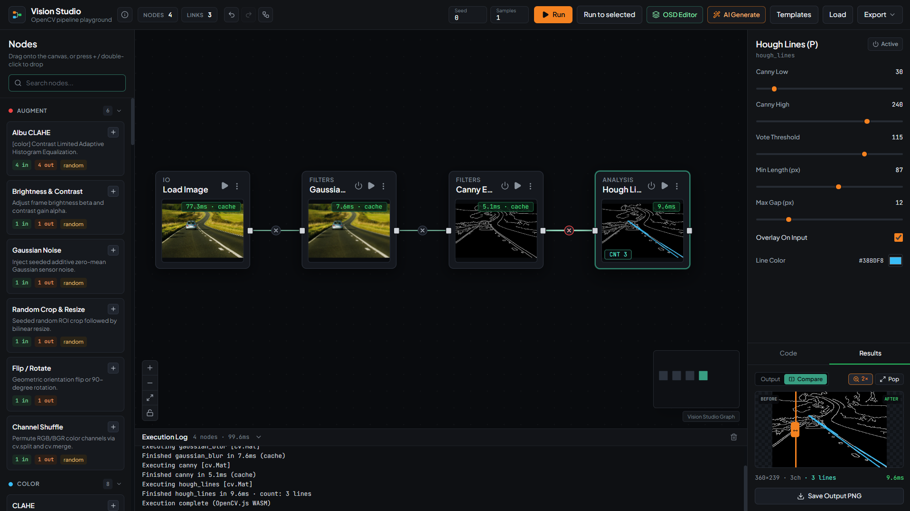
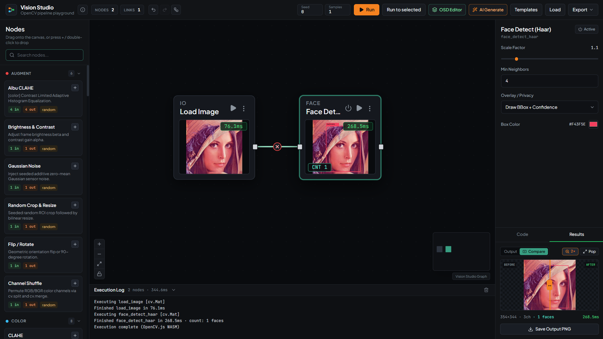
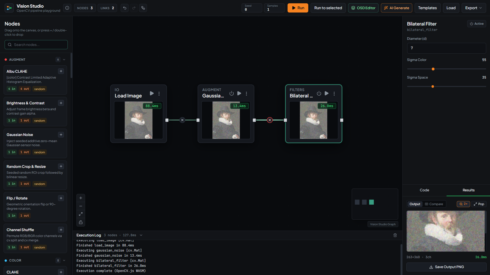

<div align="center">

# Vision Studio

**Node-Based OpenCV.js (WASM) Visual Pipeline Builder & Interactive OSD Canvas Editor**

<p>
  
  
  
  
  
  
  
</p>

Build, debug, and export real-time computer vision DAG pipelines directly in the browser—complete with per-node millisecond profiling, geometric warps (`warpAffine`, `warpPerspective`), drag-and-drop OpenCV On-Screen Display (OSD) annotation, standalone Python `cv2` code export, and prompt-driven AI pipeline synthesis.

</div>

---

## Showcase

<!-- Full-width hero screenshot -->
<p align="center">
  
</p>

<!-- 3 columns x 3 rows gallery grid -->
<table>
  <tr>
    <td width="33.3%" align="center" valign="top">
      
      <br />
      <sub><strong>14-Node Reference DAG</strong><br />CLAHE, HSV, InRange, Canny, Dilate &amp; Blend</sub>
    </td>
    <td width="33.3%" align="center" valign="top">
      
      <br />
      <sub><strong>OSD Drawing Studio</strong><br />Live Sharpen, Histogram &amp; OSD Canvas Overlay</sub>
    </td>
    <td width="33.3%" align="center" valign="top">
      
      <br />
      <sub><strong>Contour &amp; BBox Analysis</strong><br />Grayscale, Binary Threshold &amp; Find Contours</sub>
    </td>
  </tr>
  <tr>
    <td width="33.3%" align="center" valign="top">
      
      <br />
      <sub><strong>OSD Drag &amp; Drop Editor (PCB)</strong><br /><code>cv.rectangle</code>, <code>cv.circle</code> &amp; <code>cv.putText</code></sub>
    </td>
    <td width="33.3%" align="center" valign="top">
      
      <br />
      <sub><strong>OSD Drag &amp; Drop Editor (Portrait)</strong><br />Reticle, Vector Arrow, BBox &amp; Telemetry HUD</sub>
    </td>
    <td width="33.3%" align="center" valign="top">
      
      <br />
      <sub><strong>Counters &amp; OSD <code>{count}</code> Binding</strong><br />Find Contours (<code>CNT 6</code>) wired to OSD Canvas &amp; Telemetry HUD</sub>
    </td>
  </tr>
  <tr>
    <td width="33.3%" align="center" valign="top">
      
      <br />
      <sub><strong>Hough Lines (P) &amp; Compare Slider</strong><br />Canny edge lane extraction with <code>CNT 3</code> &amp; Before/After split</sub>
    </td>
    <td width="33.3%" align="center" valign="top">
      
      <br />
      <sub><strong>Haar Face Detection (<code>CNT 1</code>)</strong><br />Real-time OpenCV face bounding box, score &amp; Before/After view</sub>
    </td>
    <td width="33.3%" align="center" valign="top">
      
      <br />
      <sub><strong>Noise &amp; Bilateral Filtering</strong><br />Seeded Gaussian sensor noise followed by edge-preserving smoothing</sub>
    </td>
  </tr>
</table>

---

## Project Structure

```text
vision-studio/
├── docs/                                # README showcase screenshots
│   ├── Screenshot_2026-11-27_132605.png
│   ├── Screenshot_2026-11-27_132610.png
│   ├── Screenshot_2026-11-27_132856.png
│   ├── Screenshot_2026-11-27_132346.png
│   ├── Screenshot_2026-11-27_133327.png
│   ├── Screenshot_2026-11-27_132846.png
│   ├── Screenshot_2026-11-27_154832.png
│   ├── Screenshot_2026-11-27_154937.png
│   ├── Screenshot_2026-11-27_155040.png
│   └── Screenshot_2026-11-27_155357.png
├── public/
│   ├── opencv/                          # Local OpenCV.js WASM bundle
│   └── samples/
│       └── lena.jpg                     # Default portrait sample image
├── src/
│   ├── components/
│   │   ├── AIGenerateModal.tsx          # Prompt + reference image AI pipeline modal
│   │   ├── BatchSamplesModal.tsx        # Multi-seed batch comparison grid modal
│   │   ├── ExecutionLog.tsx             # Bottom execution & cache timing log
│   │   ├── GeometryEditorModal.tsx      # Interactive Perspective & Crop ROI visual picker
│   │   ├── InspectorSidebar.tsx         # Node params, Python Code, Compare & Pixel Probe
│   │   ├── NodeLibrarySidebar.tsx       # Searchable, categorized OpenCV node palette
│   │   ├── OSDEditorModal.tsx           # Interactive drag & drop OpenCV OSD canvas editor
│   │   ├── PipelineCanvas.tsx           # Pan/zoom node graph, ports, smooth-step edges & MiniMap
│   │   ├── ResultPreviewModal.tsx       # Resizable Compact/Large/Full result inspection popup
│   │   └── TopBar.tsx                   # Studio header, Seed/Samples, Run, OSD/AI, Templates & Export
│   ├── data/
│   │   ├── nodeCatalog.ts               # 40+ OpenCV node specs, ports, defaults & categories
│   │   └── templates.ts                 # Built-in reference & OSD templates
│   ├── engine/
│   │   ├── codeGenerator.ts             # Topological Python OpenCV (cv2) script synthesizer
│   │   ├── cvEngine.ts                  # Dual OpenCV.js WASM + pixel-buffer DAG execution engine
│   │   └── sampleImages.ts              # Sample image loader & synthetic test pattern generators
│   ├── types/
│   │   └── pipeline.ts                  # Core graph, node, port, parameter & OSD types
│   ├── App.tsx                          # Root responsive 3-pane studio workspace
│   ├── index.css                        # Tailwind CSS v4 & studio dark theme styling
│   └── main.tsx                         # React entry point
├── server.ts                            # Express server (Vite dev middleware + /api/ai/* proxy)
├── .env.example                         # Environment variable template
├── .gitignore
├── index.html                           # Fonts & async OpenCV.js WASM loader
├── metadata.json                        # Applet manifest
├── package.json
├── tsconfig.json
└── vite.config.ts
```

---

## Apps System Architecture

```text
+-----------------------------------------------------------------------------------+
|                              Browser Client (React 19)                            |
|                                                                                   |
|  +------------------+   +---------------------------------+   +----------------+  |
|  | NodeLibrary      |   | PipelineCanvas (SVG + DOM)      |   | Inspector      |  |
|  | Drag / + / DblClk|-->| Topological DAG & Live Previews |<->| Params / Code  |  |
|  +------------------+   +----------------+----------------+   | Results / PNG  |  |
|                                          |                    +----------------+  |
|                                          v                                        |
|  +-----------------------------------------------------------------------------+  |
|  |              OSDEditorModal (Drag & Drop Canvas Overlay Editor)             |  |
|  |   Stencils: BBox | Rect | Circle | Line | Arrow | Text | Crosshair Reticle  |  |
|  +---------------------------------------+-------------------------------------+  |
|                                          |                                        |
|                                          v                                        |
|  +-----------------------------------------------------------------------------+  |
|  |                  Dual Execution Engine (src/engine/cvEngine.ts)             |  |
|  |   1. OpenCV.js WASM (window.cv.Mat, CLAHE, warpAffine, warpPerspective, OSD)|  |
|  |   2. Deterministic Pixel-Buffer Engine (60fps instant execution + cache)    |  |
|  +-----------------------------------------------------------------------------+  |
+------------------------------------------+----------------------------------------+
                                           | POST /api/ai/generate-pipeline
                                           v
+-----------------------------------------------------------------------------------+
|                          Express Server Proxy (server.ts)                         |
|                                                                                   |
|  - Validates prompt & enforces server-side secret boundary                        |
|  - Injects AI_BASE_URL, AI_MODEL, AI_SECRET from process.env                      |
|  - Calls OpenAI-Compatible /chat/completions & sanitizes DAG against NODE_CATALOG |
+------------------------------------------+----------------------------------------+
                                           | HTTPS Authorization: Bearer <AI_SECRET>
                                           v
                          [ OpenAI-Compatible LLM Service ]
```

### Key Architectural Highlights
- **Zero-Latency Dual Execution**: Pipelines begin executing immediately via the deterministic TypeScript `ImageData` engine and seamlessly leverage `OpenCV.js (WASM)` primitives (`cv.CLAHE`, `cv.warpAffine`, `cv.warpPerspective`, `cv.rectangle`, `cv.circle`, `cv.line`, `cv.arrowedLine`, `cv.putText`) once WASM initializes.
- **Signature-Based Node Caching**: Each node hashes its type, parameters, seed, and upstream input signatures; unchanged upstream branches resolve instantaneously from cache (`ms · cache`).
- **Server-Side AI Boundary**: API credentials (`AI_SECRET`) and upstream model routing (`AI_BASE_URL`, `AI_MODEL`) remain strictly inside `server.ts`. Returned LLM graphs are sanitized against the whitelisted node catalog before entering client state.

---

## Tech Stack

| Layer | Technology | Purpose |
| :--- | :--- | :--- |
| **UI Framework** | React 19, TypeScript | Modular responsive studio layout & node graph UI |
| **Styling** | Tailwind CSS v4, Lucide Icons | High-contrast dark studio theme, tabular metrics, icons |
| **Vision Runtime** | OpenCV.js WASM 4.10 + HTML5 Canvas | Real-time image processing, geometric warps & OSD drawing |
| **Graph & OSD Editor** | Custom SVG + Pointer Events | Smooth-step circuit wires, pan/zoom, MiniMap, drag-and-drop OSD |
| **Code Export** | Custom Topological Emitter | Standalone Python `cv2` + `numpy` script generation |
| **Backend & AI Proxy** | Node.js 22, Express 4, `tsx` | Serves Vite / static `dist/` and `/api/ai/*` OpenAI proxy |
| **Build Tooling** | Vite 8 | Fast bundling and production asset pipeline |

---

## How to Build

### 1. Prerequisites
- **Node.js** `>= 20.x` (Node 22 recommended for native `node server.ts` execution)
- **npm** `>= 10.x`

### 2. Configure Environment Variables
Copy `.env.example` to `.env` and fill in your OpenAI-compatible credentials (optional if using only manual/template pipelines):

```bash
cp .env.example .env
```

```env
AI_BASE_URL=https://api.openai.com/v1
AI_MODEL=gpt-4o-mini
AI_SECRET=sk-your-api-key
```

### 3. Install & Run Development Server

```bash
npm install
npm run dev
```

The Express + Vite development server starts on **`http://localhost:3000`**.

### 4. Typecheck & Production Build

```bash
npm run lint
npm run build
```

This runs `tsc --noEmit` and outputs the production client bundle to `dist/`.

---

## How to Deploy

Vision Studio runs as a single full-stack Node.js/Express service serving both the static `dist/` frontend and `/api/ai/*` endpoints.

### Option A: Direct Node.js Deployment

1. Build the frontend assets:
   ```bash
   npm ci
   npm run build
   ```
2. Set production environment variables (`NODE_ENV=production`, `PORT=3000`, `AI_BASE_URL`, `AI_MODEL`, `AI_SECRET`).
3. Start the server:
   ```bash
   NODE_ENV=production npm start
   ```

### Option B: Container / Cloud Run Deployment

```dockerfile
FROM node:22-slim
WORKDIR /app
COPY package*.json ./
RUN npm ci
COPY . .
RUN npm run build
ENV NODE_ENV=production
ENV PORT=3000
EXPOSE 3000
CMD ["npm", "start"]
```

Configure `AI_BASE_URL`, `AI_MODEL`, and `AI_SECRET` via your cloud provider's **Secrets / Environment Variables** panel before exposing the service publicly.
